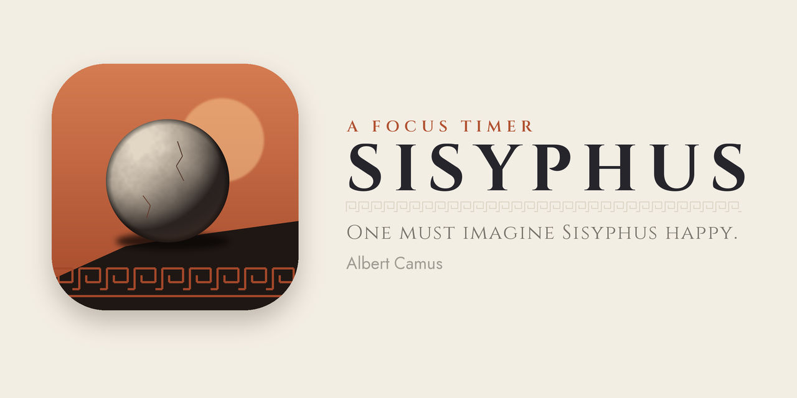

<p align="center"></p>

# Sisyphus

A focus timer where you push the boulder.

Set how long you want to focus, how long to rest and how many rounds. While
you focus you see through Sisyphus's eyes: your hands on the stone, the
slope rising under a heavy sky. When the ascent ends the stone rolls back
down and you rest in the valley, where it's calm and green and an owl
watches from a broken column. After the last climb you reach the summit:
Sisyphus sits against his boulder above the clouds, and you get the numbers
of your session and a short poem.

- **Ascend / Rest** with a big timer on top. Tap it to pause.
- **Skip** a phase, or **Exit** (your focus still counts).
- **Motivate** gives the boulder a shove. There are a few other secrets.
- **The ledger:** mountains climbed, hours focused, metres climbed,
  streaks, the week, focus per label.
- **Labels:** say what a session is for (Study, Work, ...).
- **Laurels:** achievements that unlock new stones for the boulder
  (sandstone, marble, obsidian, gold...). Some are secret.
- **Long rest** after every few climbs, by a campfire.
- **Ambient sound:** wind on the climb, the stream and birds (or crickets)
  in the valley. Generated in code, mixes with your music.
- **Share the summit:** the scene, your numbers and the poem as an image.
- Alerts when a phase ends while the app is closed, and on Android a live
  countdown in the notification shade.
- Light and dark (day and night on the mountain).
- Small and light on the battery: every scene and sound is made in code,
  scenes run at 60 or 30 fps, and nothing runs in the background.

## Getting it

Every update builds a new release automatically. Open **[Releases](../../releases)**
and take the latest build: `Sisyphus-N.apk` for Android, `Sisyphus-N.ipa`
for iPhone (sideload with [Sideloadly](https://sideloadly.io)).

## Building from source

Needs Flutter (stable, 3.47 or newer).

```bash
flutter create --org com.dingo --project-name sisyphus --platforms android,ios .
flutter pub get
flutter run --release
```

The repository only holds the platform files we changed; `flutter create`
fills in the rest without overwriting them. Checks: `flutter analyze` and
`flutter test`.

| Where | What |
|---|---|
| `lib/core/` | Session logic, settings, stats, alerts, poems |
| `lib/scene/` | The drawn scenes (ascent, rest, summit) |
| `lib/screens/` | Home, climb, summit, stats, settings |
| `test/` | Session logic and screen tests at phone size |
| `tool/` | Icon generator, store helpers |
| `docs/` | [Developer guide](docs/DEVELOPMENT.md), [change log](docs/CHANGELOG.md), [release roadmap](docs/RELEASE.md) |

Fonts: Cinzel and Jost (SIL Open Font License, `assets/fonts/OFL.txt`).
